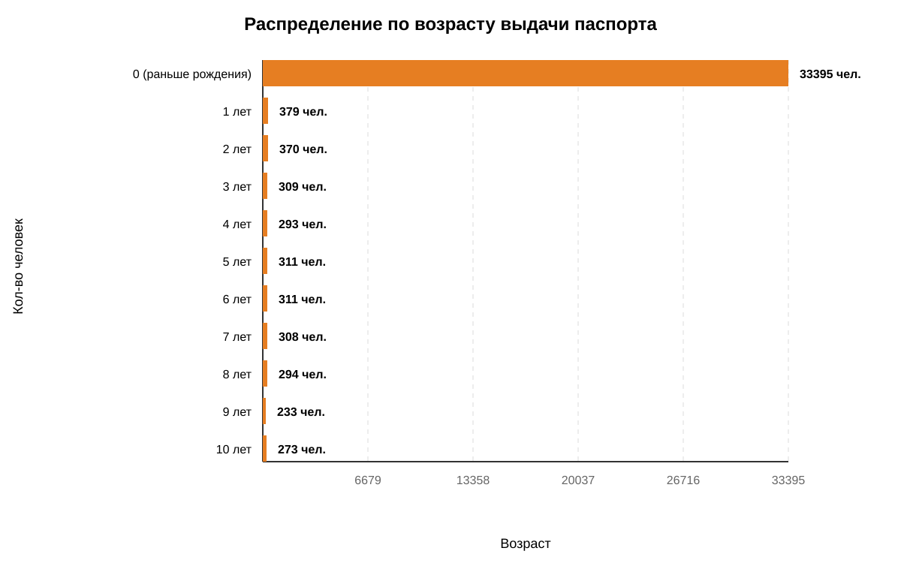
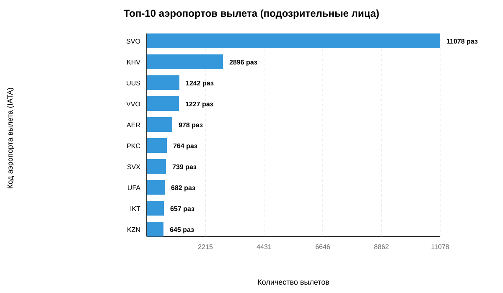
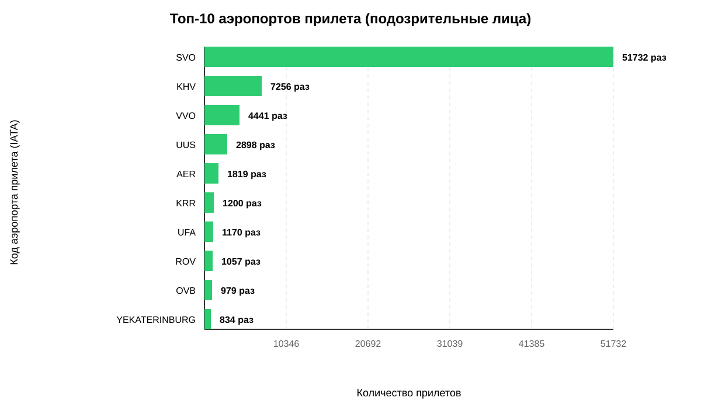

# Статический анализ пассажиров (Поиск шпионов)

## 🔴 1. Главные подозреваемые (Критические находки)
| Подозреваемый | Аномалия паспорта | Чаще всего вылетал из | Чаще всего прилетал в |
|---|---|---|---|
| **BUROV RAMIL** | Нет (нормальный) | `DAY` (1), `DTW` (1), `FCO` (1) | `EWR` (1), `JFK` (1), `MEX` (1) |
| **GLEBOV GORDEI** | Нет (нормальный) | `MCX` (2), `ATH` (1), `FCO` (1) | `SVO` (7), `ATH` (1), `CDG` (1) |
| **GOLOVINA OLESIA** | ⚠️ **Да (раньше рождения)** | `AHB` (3), `JED` (3), `RUH` (3) | `SVO` (5), `RUH` (4), `AER` (3) |
| **MASLENNIKOV ROMAN** | Нет (нормальный) | `SHA` (2), `CTU` (1), `DQA` (1) | `SHA` (3), `SVO` (2), `CTU` (1) |

---

## 2. Паспорта, выданные ранее 11 лет
- **Уникальных людей с аномалией:** 36310

### Распределение по возрасту выдачи

## 3. Общая география подозрительных лиц
### Откуда они вылетали (Топ-10 аэропортов)

### Куда они прилетали (Топ-10 аэропортов)

